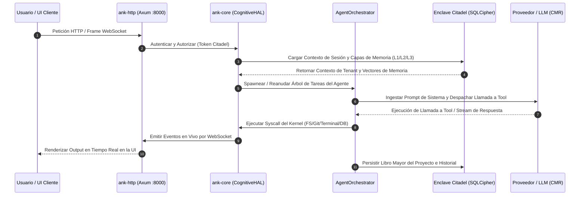

# Aegis OS — Tu Asistente Personal Autónomo y Auto-Alojado

> **Un único chat infinito. Memoria de corto y largo plazo. Agentes autónomos en segundo plano. Todo en un único binario en Rust.**
>
> 🌐 **[🇺🇸 Read in English](README.md)** · **[⚡ Probá el Cerebro en 30s (`agent_sandbox`)](tools/agent_sandbox/README.md)** · **[🤝 Cómo Colaborar (`EPIC 58`)](CONTRIBUTING.md)**

[](LICENSE)
[](https://github.com/Gustavo324234/Aegis-Core/actions)
[](Cargo.toml)
[](ARCHITECTURE.md)
[](https://github.com/sponsors/Gustavo324234)

---

## 🤖 ¿Qué es Aegis?

Aegis es **un asistente personal privado y auto-alojado**, construido sobre un motor cognitivo determinístico en Rust (`ank-server`).

En lugar de obligarte a abrir decenas de chats descartables que olvidan quién sos, Aegis te da **una única conversación infinita** que aprende sobre vos a medida que hablás, lleva tus finanzas y recordatorios cotidianos, y delega tareas pesadas a agentes en segundo plano sin trabar tu charla:

| Capacidad | Ejemplo Real en el Chat | Cómo lo Resuelve Aegis |
| :--- | :--- | :--- |
| **💰 Finanzas e Inferencia Semántica** | *"Agregá $10.000 de súper y $4.500 de carnicería"* | Deduce automáticamente que ambos corresponden a la categoría **`comida`**, los registra en tu libro contable cifrado y te informa el acumulado en <1s. |
| **🧠 Memoria a Corto y Largo Plazo** | *"Acordate que soy intolerante a la lactosa y entreno los martes a las 19hs"* | Guarda tus preferencias, rutinas y datos clave en memoria de largo plazo (`facts` + vectores L3) y los tiene presentes en cada charla futura. |
| **🌙 Aprendizaje Nocturno (`Chronos`)** | Comentás al pasar en una charla en qué proyecto estás trabajando | El motor `Chronos` analiza tus conversaciones recientes cuando no estás activo y consolida hechos implícitos sin que tengas que pedírselo. |
| **⚡ Agentes en Segundo Plano (No Bloqueantes)** | *"Mientras charlamos, armame un script en Python que resuma mis gastos del mes"* | Lanza un worker autónomo (`read_file`, `write_file`, `execute_command`, `web_search`) en segundo plano, te devuelve el control del chat al instante y te avisa (`🔔 Tarea Completada`) cuando termina. |

Por debajo, Aegis no es un wrapper frágil de LangChain: corre como **un único binario nativo en Rust sin dependencias externas**, con almacenamiento cifrado por usuario (**Protocolo Citadel / SQLCipher**) y ruteo inteligente entre APIs en la nube (OpenRouter, Gemini, Anthropic, OpenAI) o modelos 100% locales vía **Ollama**.

---

## ⚡ Probá el Cerebro de Aegis en 30 Segundos (Sin Compilar Rust)

¿Querés probar la memoria conversacional, el registro semántico de gastos y los workers en segundo plano ahora mismo —o colaborar mejorando prompts y herramientas sin instalar Rust ni Node? Ejecutá el **Agent Sandbox** incluido (solo requiere Python 3.10+):

```bash
git clone https://github.com/Gustavo324234/Aegis-Core.git
cd Aegis-Core

# Configurá tu API key gratuita de Gemini u OpenRouter en .env (o usá --provider ollama)
python tools/agent_sandbox/sandbox.py

# O corré la suite automatizada de 5 escenarios del Asistente Personal:
python tools/agent_sandbox/sandbox.py --test
```

En Windows también podés ejecutar directamente **`run_sandbox.bat`**. Mirá [tools/agent_sandbox/README.md](tools/agent_sandbox/README.md) para ver todos los comandos interactivos (`/memoria`, `/gastos`, `/chronos`, `/jobs`).

---

## 🎬 Demostración del Sistema y Flujo de Ejecución

```
[ Usuario en el Chat Único Infinito ]
       │
       ├──> "Agregá $10.000 de súper"
       │         └──> [ Herramienta Personal Instantánea: log_expense_or_entry ]
       │              └──> Infiere categoría "comida" ──> Actualiza Libro ($10.000)
       │
       └──> "Armame en segundo plano un script en Python que analice mis gastos"
                 │
                 ▼
        ┌─────────────────┐
        │   Aegis Chat    │ (Conductor Conversacional Principal — Nunca se bloquea)
        └────────┬────────┘
                 │  (Lanza Worker Asíncrono en Segundo Plano)
                 ▼
     ┌───────────────────────┐
     │ Especialista / Worker │ (Proceso en Segundo Plano)
     └───────────┬───────────┘
                 │
       ┌─────────┼─────────┐
       ▼         ▼         ▼
  [ Filesystem ] [ Terminal ] [ Web Search ]
       │         │         │
       └─────────┼─────────┘
                 ▼
  🔔 Notificación en Vivo inyectada en el Chat Infinito
```

**Pilares de ingeniería:**

- **LLMs como ALUs** — los modelos de lenguaje son unidades de cómputo probabilísticas bajo un scheduler determinístico, no oráculos
- **Kernel Zero-Panic** — escrito en Rust con `clippy::unwrap_used` rechazado en CI
- **Protocolo Citadel** — autenticación multi-tenant Zero-Trust y cifrado SQLCipher en cada capa
- **Un binario** — `ank-server` sirve la API HTTP, WebSocket y la UI React sin runtime externo
- **Aegis Connect** — túneles WebSocket seguros y persistentes vinculados a tu cuenta de Orion ID

---

## Arquitectura

```
Browser / App Mobile
        │  HTTP + WebSocket
        ▼
 ank-server  (binario único Rust)
        │
        ├── ank-http    HTTP :8000  — API REST, WebSocket, UI React embebida
        ├── ank-core    Motor cognitivo — scheduler, VCM, agentes, DAG, plugins
        └── gRPC :50051 — comunicación interna, federación multi-nodo
```

### Bucle de Ejecución Cognitivo

El siguiente diagrama detalla cómo las interacciones de los clientes fluyen determinísticamente a través del gateway HTTP/WebSocket, el scheduler cognitivo (`ank-core`), el enclave cifrado de base de datos multi-tenant (Citadel SQLCipher) y los proveedores externos de inferencia LLM:



El sistema es multi-tenant: cada tenant tiene un entorno cognitivo aislado con sus propias capas de memoria (L1/L2/L3), árbol de agentes y almacenamiento cifrado (SQLCipher).

Ver [ARCHITECTURE.md](ARCHITECTURE.md) para detalle completo.

---

## Instalación Rápida

> [!IMPORTANT]
> **On-boarding Seguro e Higiene Criptográfica**:
> Los scripts `install.sh` y `install.ps1` verifican automáticamente las sumas criptográficas SHA256 de todos los binarios nativos y recursos comprimidos de la interfaz antes de su extracción.
> Si preferís inspeccionar y auditar los scripts antes de ejecutarlos (fuertemente recomendado para entornos seguros y de producción):
> 
> * **Linux/macOS:**
>   ```bash
>   curl -fsSL -o install.sh https://raw.githubusercontent.com/Gustavo324234/Aegis-Core/main/installer/install.sh
>   less install.sh # Inspeccioná el contenido del script
>   sudo bash install.sh
>   ```
> * **Windows (PowerShell como Administrador):**
>   ```powershell
>   Invoke-WebRequest -Uri https://raw.githubusercontent.com/Gustavo324234/Aegis-Core/main/installer/install.ps1 -OutFile install.ps1
>   Get-Content install.ps1 # Inspeccioná el contenido del script
>   PowerShell -ExecutionPolicy Bypass -File .\install.ps1
>   ```

Aegis distribuye binarios nativos pre-compilados para todas las plataformas principales. No se requiere compilación.

### Linux (Ubuntu 22.04+ / Debian 12+)

```bash
curl -fsSL https://raw.githubusercontent.com/Gustavo324234/Aegis-Core/main/installer/install.sh | sudo bash
```

El instalador te guía por:
1. **Modo de instalación** — Nativo (recomendado) o Docker
2. **Perfil de inferencia** — Cloud (API keys), Local (Ollama), o Híbrido
3. **Tier de hardware** — Laptop/VPS, Workstation, o servidor SRE-grade

Después de la instalación, Aegis arranca automáticamente e imprime tu URL de configuración:

```
################################################################
#          AEGIS OS — INSTALACIÓN COMPLETA                     #
################################################################

  Acceso Remoto (HTTPS): https://tu-tunel.trycloudflare.com
  URL Local:             http://192.168.1.x:8000?setup_token=...

  El token expira en 30 minutos.
  Para regenerar: sudo aegis token
################################################################
```

### macOS (Apple Silicon e Intel)

```bash
curl -fsSL https://raw.githubusercontent.com/Gustavo324234/Aegis-Core/main/installer/install.sh | sudo bash
```

El mismo `install.sh` detecta la plataforma y descarga el binario correcto (`macos-arm64` o `macos-x86_64`).

### Windows (x86_64)

Ejecutá PowerShell **como Administrador**:

```powershell
irm https://raw.githubusercontent.com/Gustavo324234/Aegis-Core/main/installer/install.ps1 | iex
```

Aegis se instala como un Servicio de Windows (`AegisOS`) y arranca automáticamente. El
instalador también agrega el CLI `aegis` al `PATH` (abrí una terminal nueva), así que los
mismos comandos del CLI de Linux funcionan — `aegis status`, `aegis logs`, `aegis diag`,
`aegis update`. Los comandos estándar de PowerShell también sirven:

```powershell
Start-Service AegisOS
Stop-Service AegisOS
Restart-Service AegisOS
Get-Service AegisOS
```

### Docker Compose (Despliegue Contenerizado en 1-Click)

Si preferís ejecutar Aegis en un contenedor aislado sin modificar dependencias ni paquetes del sistema operativo host:

```bash
curl -fsSL -o docker-compose.yml https://raw.githubusercontent.com/Gustavo324234/Aegis-Core/main/installer/docker-compose.yml
docker compose up -d
```

Aegis arrancará en `http://localhost:8000` con persistencia de datos aislada en el volumen `aegis_data`.

---

## Plataformas soportadas

Se publican binarios pre-compilados para cada commit a `main` (nightly) y cada release con tag:

| Plataforma | Arquitectura | Binario |
|---|---|---|
| Linux | x86_64 | `ank-server-linux-x86_64.tar.gz` |
| Linux | ARM64 | `ank-server-linux-arm64.tar.gz` |
| macOS | Apple Silicon (ARM64) | `ank-server-macos-arm64.zip` |
| macOS | Intel (x86_64) | `ank-server-macos-x86_64.zip` |
| Windows | x86_64 | `ank-server-windows-x86_64.zip` |

Todos los releases están disponibles en [github.com/Gustavo324234/Aegis-Core/releases](https://github.com/Gustavo324234/Aegis-Core/releases).

---

## Aegis CLI

Después de la instalación, el comando `aegis` está disponible en todo el sistema en **Linux/macOS y Windows**.

> **Windows:** el instalador despliega `aegis.ps1` más un wrapper `aegis.cmd` y los agrega al `PATH` del sistema (abrí una terminal nueva después de instalar). Los comandos de servicio de PowerShell siguen disponibles como alternativa — ver [docs/CLI_REFERENCE.md](docs/CLI_REFERENCE.md) para la tabla de equivalencias completa.

### Estado e información

```bash
aegis status          # Salud del servicio y conectividad API
aegis version         # Versión instalada
aegis logs            # Seguir logs en vivo (últimas 100 líneas)
aegis logs 200        # Seguir últimas 200 líneas
aegis diag            # Reporte diagnóstico SRE completo
```

### Control del servicio

```bash
aegis start           # Iniciar el servicio
aegis stop            # Detener el servicio
aegis restart         # Reiniciar el servicio
aegis token           # Imprimir URL de configuración con token fresco
aegis tunnel          # Iniciar manualmente el túnel Cloudflare
```

### Actualizaciones

```bash
aegis update           # Actualizar al último release estable (default)
aegis update --nightly # Actualizar al último build nightly de main
```

Ver [docs/CLI_REFERENCE.md](docs/CLI_REFERENCE.md) para referencia completa y equivalentes Windows.

---

## Compilar desde el código fuente

**Requisitos:** Rust 1.80+, Node.js 20+, `protoc`

```bash
git clone https://github.com/Gustavo324234/Aegis-Core.git
cd Aegis-Core

# Build completo: UI + binario embebido
make build-embed

# Ejecutar
./target/release/ank-server
```

---

## Estructura del Repositorio

```
aegis-core/
├── kernel/          Kernel Rust
│   ├── crates/      Arquitectura Rust modular:
│   │   ├── ank-server       Punto de entrada principal (Axum + gRPC)
│   │   ├── ank-core         Motor cognitivo — scheduler, VCM, agentes, DAG
│   │   ├── ank-http         Servidor HTTP/WebSocket (Axum) con UI React embebida
│   │   ├── ank-cli          CLI administrativa
│   │   ├── ank-mcp          Cliente Model Context Protocol
│   │   ├── aegis-supervisor Process manager basado en Rust
│   │   ├── aegis-sdk        SDK de plugins en Wasm
│   │   ├── aegis-connect-relay  Relay de Aegis Connect — túneles WebSocket persistentes
│   │   └── ank-proto        Contratos Protobuf y stubs de Rust generados
│   └── proto/       Contratos Protobuf (gRPC y protocolo de audio Siren)
├── shell/ui/        Interfaz web — React 18 / Vite / TypeScript / Tailwind
├── tools/
│   ├── agent_sandbox/      Simulador rápido en Python y launcher web aislado (:8090)
│   ├── whatsapp_bridge/    Sidecar local Node.js (Baileys) para sesiones WhatsApp por QR
│   └── antigravity_bridge/ Worker Python y hooks de IDE para delegación al SDK de Antigravity
├── app/             Cliente mobile — React Native / Expo (modos Satélite y Cloud)
├── installer/       Deployment — install.sh, install.ps1, aegis CLI, servicio systemd
├── governance/      Tickets (TICKETS_MASTER.md), epics activos, docs de arquitectura
├── run_sandbox.bat  Lanzador sandbox Windows (server web de prueba + CLI interactiva)
└── distro/          Flake de distribución Linux inmutable (NixOS)
```

---

## Hitos Completados y Roadmap Activo

Creemos en la honestidad de ingeniería absoluta. El núcleo cognitivo, la arquitectura de binario único y el protocolo Citadel están completamente validados y listos para producción. Las extensiones de última generación (como la transmisión de voz WebRTC en tiempo real y el cliente móvil) se mantienen actualmente como capas de investigación y desarrollo experimentales activas para no comprometer la estabilidad del sistema.

| Epic / Componente Central | Descripción | Madurez / Estado |
|---|---|---|
| Epic 32 | Unificación — binario único Rust | `[Core / Estable]` ✅ Listo |
| Epic 42 | Realignment — auth, OAuth, router de modelos | `[Core / Estable]` ✅ Listo |
| Epic 43 | Orquestación Jerárquica Multi-Agente | `[Core / Estable]` ✅ Listo |
| Epic 44 | Developer Workspace (terminal, explorador de archivos, Git, PR manager) | `[Core / Estable]` ✅ Listo |
| Epic 45 | Arquitectura de Agentes Cognitivos | `[Core / Estable]` ✅ Listo |
| Epic 47 | Protocolo de Agente v2 (Paradigma Tool Use reemplaza parsing de texto) | `[Core / Estable]` ✅ Listo |
| Epic 48 | Observabilidad de Shell (Widgets del Dashboard en tiempo real y pestaña Sistema) | `[Core / Estable]` ✅ Listo |
| Epic 49 | Bucle Cognitivo (Loop ReAct multi-agente y capas de memoria semántica) | `[Core / Estable]` ✅ Listo |
| Epic 50 | Inbox de Agente (Intercambios directos Usuario-Supervisor en hilos) | `[Core / Estable]` ✅ Listo |
| Epic 51 | Inteligencia de Modelos (Ollama Cloud, scoring de contexto CMR v2) | `[Core / Estable]` ✅ Listo |
| Epic 53 | Estabilización (loop real de agentes LLM, panel de observabilidad, correcciones SRE) | `[Core / Estable]` ✅ Listo |
| Epic 54 | Aegis Connect (Túneles WebSocket persistentes mapeados a Orion ID) | `[Core / Estable]` ✅ Listo |
| CORE-150 | Scripting en Sandbox (Maker Capability - sandbox JS autónomo) | `[Core / Estable]` ✅ Listo |
| CORE-151 | Integración de contexto de proyecto (VCM y seguimiento de Git) | `[Core / Estable]` ✅ Listo |
| Epic 46 | Lanzamiento Público (docs, comunidad, salud open source) | `[Core / Estable]` ✅ Listo |
| Epic 58 | **Experiencia de Asistente Personal, UX Zero-Friction y Onboarding de Comunidad** | `[Core / Estable]` ✅ Listo ([EPIC 58](governance/EPIC_58_PERSONAL_ASSISTANT_UX_AND_COMMUNITY.md)) |
| Epic 59 | **Delegación SDK Antigravity, Puente IDE Bidireccional e Identidad/Voz** | `[Core / Estable]` ✅ Listo ([EPIC 59](governance/EPIC_59_ANTIGRAVITY_SDK_AND_VOICE_IDENTITY.md)) |
| Epic 60 | **Canales Reales (WhatsApp y Google Calendar), UX de Chat y Resiliencia ReAct** | `[Core / Estable]` ✅ Listo ([EPIC 60](governance/EPIC_60_REAL_WORLD_CHANNELS_OAUTH_AND_RESILIENCE.md)) |
| Epic 61 | **Promoción de Sandbox, Hardening de Seguridad y Maduración SRE** | `[Core / Estable]` ✅ Listo ([EPIC 61](governance/EPIC_61_SANDBOX_PROMOTION_AND_SRE.md)) |
| Epic 62 | **Eficiencia Cognitiva (-60%–75% Tokens), CMR v4 y Matriz de Modelos 2026** | `[Core / Estable]` ✅ Listo ([EPIC 62](governance/EPIC_62_COGNITIVE_EFFICIENCY_AND_MODELS_2026.md)) |
| Epic 63 | **Biometría Vocal Multi-Voz (56-dim), VAD Natural y Asistente Nativo Android/PC** | `[Core / Estable]` ✅ Listo ([EPIC 63](governance/EPIC_63_VOICE_BIOMETRICS_WAKEWORD_AND_NATIVE_ASSISTANT.md)) |
| Epic 52 | Calidad de Voz (estabilización de stream Siren WebRTC y feedback de silenciar mic) | `[Experimental / I+D]` 🧪 I+D Activo |
| Epic 55 | App Móvil (modos Satélite y Cloud con integración Orion ID y Web) | `[Experimental / I+D]` 🧪 I+D Activo |

---

### Limitaciones Conocidas y Alcance de I+D

Para mantener una total honestidad de ingeniería, diferenciamos claramente entre el núcleo determinístico probado en batalla y las funcionalidades experimentales en fase de I+D:

* **Núcleo y Motor del Kernel (`ank-server`, `ank-core`, `ank-http`)**: Completamente estable, verificado mediante suites de pruebas unitarias/integración, con garantía de Zero-Panic en producción.
* **Protocolo de Voz Siren (`Epic 52`)**: El streaming de audio WebRTC en tiempo real es funcional pero se considera `[Experimental]`. La calidad del audio y la latencia dependen de los códecs del navegador del cliente y la disponibilidad del motor local STT/TTS.
* **Cliente Móvil (`Epic 55` / `app/`)**: La app en React Native Expo soporta autenticación mediante Orion ID y redirección web del workspace, pero la sincronización nativa en segundo plano se mantiene como `[Experimental]`.
* **Sandbox Maker Capability (`CORE-150`)**: La ejecución de scripts en sandbox opera en un entorno restringido, pero el soporte multihilo avanzado en plugins WASM es un módulo activo de I+D.

---

## Roadmap

- [ ] `distro/` — distribución mínima e inmutable de Linux autohospedada
- [ ] Optimización de rendimiento de Cognitive Loop y escalamiento de base de datos vectorial local (LanceDB L3)

---

## Contribuir

Aegis es open source y da la bienvenida a contribuciones.

Leé [CONTRIBUTING.md](CONTRIBUTING.md) para empezar. Se valoran contribuciones de código, documentación, traducciones y reportes de bugs.

El proyecto usa un flujo basado en tickets. Revisá [governance/TICKETS_MASTER.md](governance/TICKETS_MASTER.md) para trabajo abierto.

---

## Apoyar el Proyecto

Aegis es construido y mantenido por un solo desarrollador. Si te resulta útil, considerá apoyar su desarrollo:

- ⭐ **Dale una estrella** — ayuda con la visibilidad
- 🐛 **Reportá bugs** — abrí un issue
- 💬 **Difundilo** — compartilo con personas que construyen sistemas de IA
- ❤️ **Sponsoreá** — [github.com/sponsors/Gustavo324234](https://github.com/sponsors/Gustavo324234)

Los sponsoreos van directamente a la infraestructura de desarrollo: cómputo, costos de API y herramientas.

---

## Evidencia de Ruteo Cognitivo y Eficiencia (CMR v4 + PinchBench)

Aegis OS rutea cada turno de forma adaptativa usando evaluaciones empíricas de **PinchBench**, precios en vivo de OpenRouter y armado de contexto **Cache-First + Dynamic Tool Gating** (`EPIC 62`), reduciendo el consumo de tokens por turno entre **60% y 75%** mientras escala automáticamente preguntas complejas hacia modelos de mayor razonamiento.

### Matriz Recomendada 2026 (Perfiles Gratis y Pagos)

| ID del Modelo | Perfil | PinchBench | Costo (1M In / Out) | Rol Óptimo (`CMR v4`) |
|---|---|---|---|---|
| `anthropic/claude-opus-4.6` | Pago Frontier | **96.30%** | $5.00 / $25.00 | **Orquestación DAG / Arquitectura Crítica** |
| `deepseek/deepseek-v4-flash` | Pago Valor (#1) | **91.46%** | $0.09 / $0.18 | **Razonamiento Diario y Código (`$0.018` cache read)** |
| `openai/gpt-5.6-luna` | Pago Valor | **90.79%** | $0.20 / $1.20 | **Asistente Confiable y Síntesis** |
| `nvidia/nemotron-3-ultra-550b-a55b:free` | 100% Gratis (OR) | **90.58%** | Gratis | **Razonamiento Profundo sin Costo (1M ctx)** |
| `gemini-3.8-flash` | Free Tier (AI Studio) | **89.20%** | Free Tier | **Asistente Diario Gratuito Principal** |
| `qwen/qwen3.8-27b` | Free Tier (Groq) | **86.40%** | Free Tier | **Failover Rápido con Tool Calling Gratis** |
| `qwen2.5-coder:32b` (Ollama) | Local Soberano | **72.10%** | Gratis (GPU Local) | **Respaldo Offline / Enclaves Air-Gapped** |

### Cómo Optimiza Inteligencia por Token Aegis (CMR v4)
1. **Cache-First + Dynamic Tool Gating:** El prefijo `System` (`messages[0]`) permanece invariante entre turnos para aprovechar KV-caching de los proveedores, el reloj y la memoria personal selectiva viajan justo antes del turno del usuario, y solo se adjuntan esquemas de herramientas del dominio activo (`0` en charla conceptual pura).
2. **`ChatComplexity` Adaptativo (`Quick` / `Standard` / `DeepReasoning`):** Saludos breves van a modelos livianos/gratis (`gemini-3.5-flash-lite`, `gpt-oss-20b`), mientras consultas analíticas o estratégicas eliminan penalizaciones de chat y desbloquean modelos razonadores con hasta `4096` tokens de salida.
3. **Blend Continuo con `benchmark_pct`:** La calidad efectiva combina `0.70 * task_score + 0.30 * benchmark_pct`, y `LocalOnly` mantiene enclaves sensibles 100% locales en Ollama.

Para instrucciones de reproducibilidad y la matriz completa 2026, ver [docs/BENCHMARKS_PINCHBENCH.md](docs/BENCHMARKS_PINCHBENCH.md).

Para notas operativas del mundo real y experiencias de resiliencia SRE, ver [docs/DOGFOODING.md](docs/DOGFOODING.md).

---

## Filosofía

**Los LLMs son ALUs, no oráculos.** Un modelo de lenguaje es una unidad de cómputo probabilística que transforma tokens. La inteligencia del sistema viene de la capa determinística que orquesta esas transformaciones — el scheduler, la jerarquía de memoria, el árbol de agentes. El modelo es una herramienta, no la mente.

**Cognición a nivel de kernel.** Las cargas de trabajo de IA deberían manejarse igual que un SO maneja procesos: scheduling, aislamiento, límites de recursos, comunicación inter-proceso. No como una llamada de librería, sino como un servicio de kernel.

**Un binario.** La complejidad operacional es deuda técnica. Un sistema que corre como un único ejecutable, sin runtime Python, sin daemon Node, sin Docker requerido, es un sistema que puede mantenerse de verdad.

---

## Licencia

MIT — ver [LICENSE](LICENSE)

Copyright (c) 2026 Gustavo Aversente
