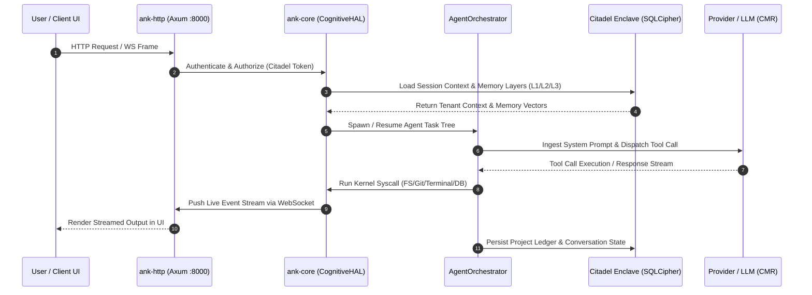

# Aegis OS — Your Self-Hosted Autonomous Personal Assistant

> **One infinite chat. Short & long-term memory. Non-blocking background agents. One single Rust binary.**
>
> 🌐 **[🇪🇸 Leer en Español](README.es.md)** · **[⚡ Try the Brain in 30s (`agent_sandbox`)](tools/agent_sandbox/README.md)** · **[🤝 Contribute (`EPIC 58`)](CONTRIBUTING.md)**

[](LICENSE)
[](https://github.com/Gustavo324234/Aegis-Core/actions)
[](Cargo.toml)
[](ARCHITECTURE.md)
[](https://github.com/sponsors/Gustavo324234)

---

## 🤖 What is Aegis?

Aegis is a **private, self-hosted autonomous personal assistant**, built on top of a deterministic Rust cognitive engine (`ank-server`).

Instead of managing dozens of disposable chat threads that forget who you are, Aegis gives you **a single infinite conversation** that learns about your life, manages your daily finances and reminders, and spawns autonomous workers in the background while you keep talking:

| Capability | Real-World Example | How Aegis Handles It |
| :--- | :--- | :--- |
| **💰 Semantic Life & Expense Tracking** | *"Add $10,000 from the supermarket and $4,500 from the butcher"* | Automatically infers both belong to **`food` (`comida`)**, logs them to your encrypted personal ledger, and replies with your updated category total in <1s. |
| **🧠 Short-Term & Long-Term Memory** | *"Remember I'm lactose intolerant and train Tuesdays at 7 PM"* | Persists facts into long-term memory (`facts` + L3 vector swap) and injects relevant context into every future turn. |
| **🌙 Implicit Nightly Learning (`Chronos`)** | You mention a project deadline or preference in passing during a chat | The `Chronos` background daemon consolidates recent conversations while idle and extracts durable facts without you having to ask. |
| **⚡ Non-Blocking Background Workers** | *"While we chat, write a Python script that analyzes my monthly expenses"* | Spawns an autonomous background worker (`read_file`, `write_file`, `execute_command`, `web_search`) and immediately returns control of the chat, notifying you (`🔔 Background Task Complete`) when done. |

Under the hood, Aegis is not a fragile LangChain wrapper—it runs as **a single zero-dependency Rust binary** with SQLCipher encrypted storage (**Citadel Protocol**) and multi-provider routing (OpenRouter, Gemini, Anthropic, OpenAI, and 100% local Ollama).

---

## ⚡ Try the Aegis Brain in 30 Seconds (Zero Rust Build Required)

Want to test Aegis's conversational memory, semantic expense tracking, and background workers right now—or contribute prompt/tool improvements without compiling Rust? Run the standalone **Agent Sandbox** (requires only Python 3.10+):

```bash
git clone https://github.com/Gustavo324234/Aegis-Core.git
cd Aegis-Core

# Configure a free Gemini or OpenRouter API key in .env (or use --provider ollama)
python tools/agent_sandbox/sandbox.py

# Or run the automated 5-scenario Personal Assistant verification suite:
python tools/agent_sandbox/sandbox.py --test

# On Windows, launch both the isolated test web server (http://localhost:8090) and CLI:
run_sandbox.bat   # Use run_sandbox.bat --server-only to launch only the test server
```

See [tools/agent_sandbox/README.md](tools/agent_sandbox/README.md) for all interactive commands (`/memoria`, `/gastos`, `/chronos`, `/jobs`).

---

## 🎬 System Showcase & Execution Flow

```
[ User in Single Infinite Chat ]
       │
       ├──> "Add $10,000 from the supermarket"
       │         └──> [ Instant Personal Tool: log_expense_or_entry ]
       │              └──> Infers category "comida" ──> Updates Ledger ($10,000)
       │
       └──> "Build & test a Python expense report script in the background"
                 │
                 ▼
        ┌─────────────────┐
        │   Aegis Chat    │ (Main Conversational Conductor — Never Blocks)
        └────────┬────────┘
                 │  (Spawns Non-Blocking Background Worker)
                 ▼
     ┌───────────────────────┐
     │ Background Specialist │ (Worker Process)
     └───────────┬───────────┘
                 │
       ┌─────────┼─────────┐
       ▼         ▼         ▼
  [ Filesystem ] [ Terminal ] [ Web Search ]
       │         │         │
       └─────────┼─────────┘
                 ▼
  🔔 Live Notification injected back into Infinite Chat
```

**Core engineering pillars:**

- **LLMs as ALUs** — language models are probabilistic compute units under a deterministic scheduler, not oracles
- **Zero-Panic kernel** — written in Rust with `clippy::unwrap_used` denied at CI level
- **Citadel Protocol** — Zero-Trust multi-tenant authentication and SQLCipher encryption at every layer
- **One binary** — `ank-server` serves the HTTP API, WebSocket streams, and the React UI with no external runtime
- **Aegis Connect** — secure, persistent WebSocket tunnels mapping your local instance to a permanent URL via Orion ID

---

## Architecture

```
Browser / Mobile App
        │  HTTP + WebSocket
        ▼
 ank-server  (single Rust binary)
        │
        ├── ank-http    HTTP :8000  — REST API, WebSocket, embedded React UI
        ├── ank-core    Cognitive engine — scheduler, VCM, agents, DAG, plugins
        └── gRPC :50051 — internal communication, multi-node federation
```

### Cognitive Execution Loop

The diagram below illustrates how client interactions flow deterministically through the HTTP/WebSocket gateway, the cognitive scheduler (`ank-core`), the multi-tenant encrypted database enclave (Citadel SQLCipher), and external LLM inference providers:



The system is multi-tenant: each tenant gets an isolated cognitive environment with its own memory layers (L1/L2/L3), agent tree, and encrypted data store (SQLCipher).

See [ARCHITECTURE.md](ARCHITECTURE.md) for full detail.

---

## Quick Install

> [!IMPORTANT]
> **Secure On-boarding & Cryptographic Hygiene**:
> The `install.sh` and `install.ps1` scripts automatically verify the cryptographic SHA256 checksums of all native binaries and compressed UI assets before extraction.
> If you prefer to inspect and audit the scripts before executing them (strongly recommended for production and secure environments):
> 
> * **Linux/macOS:**
>   ```bash
>   curl -fsSL -o install.sh https://raw.githubusercontent.com/Gustavo324234/Aegis-Core/main/installer/install.sh
>   less install.sh # Inspect script contents
>   sudo bash install.sh
>   ```
> * **Windows (PowerShell as Admin):**
>   ```powershell
>   Invoke-WebRequest -Uri https://raw.githubusercontent.com/Gustavo324234/Aegis-Core/main/installer/install.ps1 -OutFile install.ps1
>   Get-Content install.ps1 # Inspect script contents
>   PowerShell -ExecutionPolicy Bypass -File .\install.ps1
>   ```

Aegis ships pre-built native binaries for all major platforms. No compilation required.

### Linux (Ubuntu 22.04+ / Debian 12+)

```bash
curl -fsSL https://raw.githubusercontent.com/Gustavo324234/Aegis-Core/main/installer/install.sh | sudo bash
```

The installer guides you through:
1. **Installation mode** — Native (recommended) or Docker
2. **Inference profile** — Cloud (API keys), Local (Ollama), or Hybrid
3. **Hardware tier** — Laptop/VPS, Workstation, or SRE-grade server

After install, Aegis starts automatically and prints your setup URL:

```
################################################################
#          AEGIS OS — INSTALLATION COMPLETE                    #
################################################################

  Remote Access (HTTPS): https://your-tunnel.trycloudflare.com
  Local Setup URL:        http://192.168.1.x:8000?setup_token=...

  Token expires in 30 minutes.
  To regenerate: sudo aegis token
################################################################
```

### macOS (Apple Silicon & Intel)

```bash
curl -fsSL https://raw.githubusercontent.com/Gustavo324234/Aegis-Core/main/installer/install.sh | sudo bash
```

The same `install.sh` detects the platform and downloads the correct binary (`macos-arm64` or `macos-x86_64`).

### Windows (x86_64)

Run PowerShell **as Administrator**:

```powershell
irm https://raw.githubusercontent.com/Gustavo324234/Aegis-Core/main/installer/install.ps1 | iex
```

Aegis installs as a Windows Service (`AegisOS`) and starts automatically. The installer
also adds the `aegis` CLI to your `PATH` (open a new terminal), so the same commands from
the Linux CLI work — `aegis status`, `aegis logs`, `aegis diag`, `aegis update`. Standard
PowerShell service commands work too:

```powershell
Start-Service AegisOS
Stop-Service AegisOS
Restart-Service AegisOS
Get-Service AegisOS
```

### Docker Compose (1-Click Containerized Mode)

If you prefer running Aegis in an isolated container without installing host system packages:

```bash
curl -fsSL -o docker-compose.yml https://raw.githubusercontent.com/Gustavo324234/Aegis-Core/main/installer/docker-compose.yml
docker compose up -d
```

Aegis will spin up on `http://localhost:8000` with isolated data persistence in the `aegis_data` volume.

---

## Platform Support

Pre-built binaries are published for every commit to `main` (nightly) and every tagged release:

| Platform | Architecture | Binary |
|---|---|---|
| Linux | x86_64 | `ank-server-linux-x86_64.tar.gz` |
| Linux | ARM64 | `ank-server-linux-arm64.tar.gz` |
| macOS | Apple Silicon (ARM64) | `ank-server-macos-arm64.zip` |
| macOS | Intel (x86_64) | `ank-server-macos-x86_64.zip` |
| Windows | x86_64 | `ank-server-windows-x86_64.zip` |

All releases are available at [github.com/Gustavo324234/Aegis-Core/releases](https://github.com/Gustavo324234/Aegis-Core/releases).

---

## Aegis CLI

After installation, the `aegis` command is available system-wide on **Linux/macOS and Windows**.

> **Windows:** the installer deploys `aegis.ps1` plus an `aegis.cmd` wrapper and adds them to the system `PATH` (open a new terminal after installing). PowerShell service commands remain available as an alternative — see [docs/CLI_REFERENCE.md](docs/CLI_REFERENCE.md) for the full equivalents table.

### Status & Info

```bash
aegis status          # Service health and API connectivity
aegis version         # Installed version
aegis logs            # Follow live logs (last 100 lines)
aegis logs 200        # Follow last 200 lines
aegis diag            # Deep SRE diagnostic report
```

### Service Control

```bash
aegis start           # Start the service
aegis stop            # Stop the service
aegis restart         # Restart the service
aegis token           # Print setup URL with fresh token
aegis tunnel          # Manually start Cloudflare Tunnel
```

### Updates

```bash
aegis update           # Update to latest stable release (default)
aegis update --nightly # Update to latest nightly build from main
```

See [docs/CLI_REFERENCE.md](docs/CLI_REFERENCE.md) for full command reference and Windows equivalents.

---

## Build from Source

**Requirements:** Rust 1.80+, Node.js 20+, `protoc`

```bash
git clone https://github.com/Gustavo324234/Aegis-Core.git
cd Aegis-Core

# Full build: UI + embedded binary
make build-embed

# Run
./target/release/ank-server
```

Build options:

| Command | Output | Notes |
|---|---|---|
| `make build` | Binary + separate UI assets | Set `UI_DIST_PATH=shell/ui/dist` at runtime |
| `make build-embed` | Single self-contained binary | No external files needed |
| `./build.sh` | Same as `make build` | Shell script alternative |

---

## Repository Structure

```
aegis-core/
├── kernel/          Rust kernel
│   ├── crates/      Modular Rust architecture:
│   │   ├── ank-server       Main binary entrypoint (Axum + gRPC)
│   │   ├── ank-core         Cognitive engine — scheduler, VCM, agents, DAG
│   │   ├── ank-http         HTTP/WebSocket server (Axum) with embedded React UI
│   │   ├── ank-cli          Administrative CLI
│   │   ├── ank-mcp          Model Context Protocol client
│   │   ├── aegis-supervisor Rust-based process manager
│   │   ├── aegis-sdk        Wasm plugin SDK
│   │   ├── aegis-connect-relay  Aegis Connect relay — persistent WebSocket tunnels
│   │   └── ank-proto        Protobuf contracts & generated Rust code
│   └── proto/       Protobuf contracts (gRPC & Siren audio protocol)
├── shell/ui/        Web interface — React 18 / Vite / TypeScript / Tailwind
├── tools/
│   ├── agent_sandbox/      Fast Python Personal Assistant simulator & isolated web launcher (:8090)
│   ├── whatsapp_bridge/    Local Node.js Baileys sidecar for multi-tenant WhatsApp QR sessions
│   └── antigravity_bridge/ Python SDK worker & IDE hooks for Antigravity agent delegation
├── app/             Mobile client — React Native / Expo (Satellite and Cloud modes)
├── installer/       Deployment — install.sh, install.ps1, aegis CLI, systemd service
├── governance/      Tickets (TICKETS_MASTER.md), active epics, architecture docs
├── run_sandbox.bat  Windows sandbox launcher (test web server + interactive CLI)
└── distro/          NixOS immutable Linux distribution flake
```

---

## Completed Milestones & Active Roadmap

We believe in absolute engineering honesty. The core cognitive kernel, single-binary architecture, and Citadel protocol are fully validated and production-ready. Cutting-edge extensions (like real-time WebRTC voice streaming and the mobile app client) are currently active, functional experimental R&D layers to prevent technical bloat.

| Epic / Core Component | Description | Maturity / Status |
|---|---|---|
| Epic 32 | Unification — single Rust binary | `[Core / Stable]` ✅ Done |
| Epic 42 | Realignment — auth, OAuth, model router | `[Core / Stable]` ✅ Done |
| Epic 43 | Hierarchical Multi-Agent Orchestration | `[Core / Stable]` ✅ Done |
| Epic 44 | Developer Workspace (terminal, file browser, Git, PR manager) | `[Core / Stable]` ✅ Done |
| Epic 45 | Cognitive Agent Architecture | `[Core / Stable]` ✅ Done |
| Epic 47 | Agent Protocol v2 (Tool Use paradigm replacing text parsing) | `[Core / Stable]` ✅ Done |
| Epic 48 | Shell Observability (Dashboard real-time widgets & service tab) | `[Core / Stable]` ✅ Done |
| Epic 49 | Cognitive Loop (Multi-agent ReAct loop & memory layers) | `[Core / Stable]` ✅ Done |
| Epic 50 | Agent Inbox (Direct User-Supervisor thread exchanges) | `[Core / Stable]` ✅ Done |
| Epic 51 | Model Intelligence (Ollama Cloud, CMR v2 context scoring) | `[Core / Stable]` ✅ Done |
| Epic 53 | Stabilization (Real LLM agent loop, observability dashboard, SRE fixes) | `[Core / Stable]` ✅ Done |
| Epic 54 | Aegis Connect (Persistent WebSocket tunneling mapped to Orion ID) | `[Core / Stable]` ✅ Done |
| CORE-150 | Sandbox scripting (Maker Capability - autonomous JS sandbox) | `[Core / Stable]` ✅ Done |
| CORE-151 | Project context integration (Git/VCM active context tracking) | `[Core / Stable]` ✅ Done |
| Epic 46 | Public Launch (docs, community, open source health) | `[Core / Stable]` ✅ Done |
| Epic 58 | **Personal Assistant Experience, Zero-Friction UX & Community Onboarding** | `[Core / Stable]` ✅ Done ([EPIC 58](governance/EPIC_58_PERSONAL_ASSISTANT_UX_AND_COMMUNITY.md)) |
| Epic 59 | **Antigravity SDK Delegation, Bidirectional IDE Bridge & Voice/Identity Studio** | `[Core / Stable]` ✅ Done ([EPIC 59](governance/EPIC_59_ANTIGRAVITY_SDK_AND_VOICE_IDENTITY.md)) |
| Epic 60 | **Real-World Channels (WhatsApp & Google Calendar), Chat UX & ReAct Resilience** | `[Core / Stable]` ✅ Done ([EPIC 60](governance/EPIC_60_REAL_WORLD_CHANNELS_OAUTH_AND_RESILIENCE.md)) |
| Epic 61 | **Sandbox Promotion, Security Hardening & SRE Maturation** | `[Core / Stable]` ✅ Done ([EPIC 61](governance/EPIC_61_SANDBOX_PROMOTION_AND_SRE.md)) |
| Epic 62 | **Cognitive Efficiency (-60%–75% Tokens), CMR v4 & 2026 Model Matrix** | `[Core / Stable]` ✅ Done ([EPIC 62](governance/EPIC_62_COGNITIVE_EFFICIENCY_AND_MODELS_2026.md)) |
| Epic 63 | **Hands-Free Voice Biometrics (56-dim), Breath-Aware VAD & Native Android/PC Assistant** | `[Core / Stable]` ✅ Done ([EPIC 63](governance/EPIC_63_VOICE_BIOMETRICS_WAKEWORD_AND_NATIVE_ASSISTANT.md)) |
| Epic 52 | Voice Quality (Siren WebRTC stream stabilization & mic-mute feedback) | `[Experimental / R&D]` 🧪 Active R&D |
| Epic 55 | Mobile App (Satellite and Cloud modes with Orion ID & Web integration) | `[Experimental / R&D]` 🧪 Active R&D |

---

### Known Limitations & Active R&D Boundaries

To maintain engineering honesty, we clearly distinguish between our battle-tested deterministic core and experimental R&D features:

* **Core & Kernel Engine (`ank-server`, `ank-core`, `ank-http`)**: Fully stable, tested with unit/integration suites, and enforced Zero-Panic in production.
* **Siren Voice Protocol (`Epic 52`)**: Real-time WebRTC audio streaming is functional but considered `[Experimental]`. Audio quality and latency depend heavily on client browser WebSockets/WebRTC codecs and local STT/TTS engine availability.
* **Mobile Client (`Epic 55` / `app/`)**: The React Native Expo client supports Orion ID authentication and workspace web redirection, but native background sync remains `[Experimental]`.
* **Maker Capability (`CORE-150`)**: Script sandbox execution operates in a restricted environment, but advanced multi-threading within custom WASM plugins is an evolving R&D module.

---

## Roadmap

- [ ] `distro/` — minimal immutable self-hosted Linux distribution
- [ ] Cognitive Loop performance optimization and local vector database scaling (LanceDB L3)

---

## Contributing

Aegis is open source and welcomes contributions.

Read [CONTRIBUTING.md](CONTRIBUTING.md) to get started. All contributions — code, docs, translations, bug reports — are valued.

The project uses a ticket-driven workflow. Check [governance/TICKETS_MASTER.md](governance/TICKETS_MASTER.md) for open work.

---

## Supporting the Project

Aegis is built and maintained by a solo developer. If it's useful to you, consider supporting its development:

- ⭐ **Star the repo** — helps with visibility
- 🐛 **Report bugs** — open an issue
- 💬 **Spread the word** — share with people building AI systems
- ❤️ **Sponsor** — [github.com/sponsors/Gustavo324234](https://github.com/sponsors/Gustavo324234)

Sponsorships go directly toward development infrastructure: compute, API costs, and tooling.

---

## Cognitive Routing & PinchBench Evidence (CMR v4)

Aegis OS routes every turn dynamically using empirical **PinchBench** evaluations, OpenRouter live pricing, and **Cache-First + Dynamic Tool Gating** context construction (`EPIC 62`), cutting chat token usage by **60%–75%** while automatically escalating complex prompts to stronger reasoning models.

### 2026 Curated Model Profiles (Free & Paid)

| Model ID | Tier | PinchBench | Cost (1M Input / Output) | Optimal `CMR v4` Role |
|---|---|---|---|---|
| `anthropic/claude-opus-4.6` | Paid Frontier | **96.30%** | $5.00 / $25.00 | **DAG Orchestration / Critical Architecture** |
| `deepseek/deepseek-v4-flash` | Paid Value (#1) | **91.46%** | $0.09 / $0.18 | **Daily Reasoning & Coding (`$0.018` cache read)** |
| `openai/gpt-5.6-luna` | Paid Value | **90.79%** | $0.20 / $1.20 | **High-Reliability Assistant & Synthesis** |
| `nvidia/nemotron-3-ultra-550b-a55b:free` | 100% Free (OR) | **90.58%** | Free | **Zero-Cost Deep Reasoning (1M ctx)** |
| `gemini-3.8-flash` | Free Tier (AI Studio) | **89.20%** | Free Tier | **Primary Free Daily Assistant** |
| `qwen/qwen3.8-27b` | Free Tier (Groq) | **86.40%** | Free Tier | **Fast Free Reasoning & Tool Failover** |
| `qwen2.5-coder:32b` (Ollama) | Local Sovereign | **72.10%** | Free (Host GPU) | **Offline Fallback / Air-Gapped Enclaves** |

### How Aegis Optimizes Intelligence per Token (CMR v4)
1. **Cache-First + Dynamic Tool Gating:** The base `System` prefix (`messages[0]`) stays byte-invariant across turns for provider KV-cache reuse, volatile clocks and selective personal memory sit right before the user turn, and only domain-relevant tool schemas (`0` on pure conceptual chat) are attached.
2. **Adaptive `ChatComplexity` (`Quick` / `Standard` / `DeepReasoning`):** Casual greetings hit fast/free models (`gemini-3.5-flash-lite`, `gpt-oss-20b`), while analytical or architectural prompts bypass chat penalties and unlock `DeepReasoning` models with up to `4096` output tokens.
3. **Continuous `benchmark_pct` Blending & Local-First Guard:** Model quality blends `0.70 * task_score + 0.30 * benchmark_pct`, while `LocalOnly` keeps sensitive workloads strictly on local Ollama weights.

For full reproducibility instructions and the complete 2026 matrix, see [docs/BENCHMARKS_PINCHBENCH.md](docs/BENCHMARKS_PINCHBENCH.md).

For real-world operational notes and SRE resilience experiences, see [docs/DOGFOODING.md](docs/DOGFOODING.md).

---

## Philosophy

Aegis is built on a few firm beliefs:

**LLMs are ALUs, not oracles.** A language model is a probabilistic compute unit that transforms tokens. The system's intelligence comes from the deterministic layer that orchestrates those transforms — the scheduler, the memory hierarchy, the agent tree. The model is a tool, not the mind.

**Kernel-level cognition.** AI workloads should be managed the same way an OS manages processes: scheduling, isolation, resource limits, inter-process communication. Not as a library call, as a kernel service.

**One binary.** Operational complexity is a form of technical debt. A system that runs as a single executable, with no Python runtime, no Node daemon, no Docker required, is a system that can actually be maintained.

---

## License

GNU Affero General Public License v3.0 (`AGPL-3.0-only`) — see [LICENSE](LICENSE). Commercial licensing for proprietary/closed-source deployments is available by contacting the author.

Copyright (c) 2026 Gustavo Aversente
