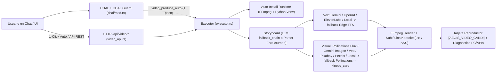

# Aegis Video Studio (`aegis.domain.video`) — Arquitectura y Flujo de Producción

Documento de referencia técnica para el módulo **Aegis Video Studio** (`aegis.domain.video`), su pipeline de producción automatizada en 1 paso (`video_produce_auto`), los motores de voz/visuales/subtítulos, la tolerancia a fallos multi-etapa, el diagnóstico de hardware local vs. planes de API y las mejoras de enrutamiento en **CHAL** y **Chat UI**.

---

## 1. Visión General y Flujo de Ejecución

Aegis Video Studio corre de forma nativa dentro de `ank-core` (`kernel/crates/ank-core/src/video_studio/`) bajo el manifiesto [module.json](file:///e:/Aegis/Aegis-Core/kernel/modules/aegis-video/module.json), persistiendo su estado cifrado por tenant en `TenantDB` (`module_data:aegis.domain.video` y `module_config:aegis.domain.video`) y almacenando archivos multimedia por proyecto bajo `<AEGIS_DATA_DIR>/users/<tenant_id>/video_studio/<project_id>/`.

---

## 2. Herramientas del Módulo (`aegis.domain.video`)

Definidas en `kernel/modules/aegis-video/module.json` y despachadas por `execute_video_tool`:

| Tool | Propósito |
| :--- | :--- |
| `video_produce_auto` | **Pipeline principal en 1 paso:** resuelve preset/voz automático, instala runtime si falta, extrae escenas (o usa `scenes`), genera voz y visuales con fallback resiliente, exporta `output.mp4` + `subtitles.srt` y devuelve `[AEGIS_VIDEO_CARD:<project_id>]` junto con `fallbacks_applied` y `advisor`. |
| `video_create_project` | Crea un proyecto desde `prompt`, `scenes` explícitas o un guion de **Aegis Creator Studio** (`creator_script_id`). Soporta `auto_render: true` para encadenar generación y exportación en el mismo paso. |
| `video_manage_scene` | Operaciones `add`, `update`, `delete` y `move` sobre escenas individuales, incluyendo overrides `visual_override` y `voice_override`. |
| `video_configure_engines` | Configura presets/motores por defecto del módulo o de un `project_id`, además de claves multimedia (`pexels_api_key` compatible con Pixabay/Pexels, `elevenlabs_api_key`) y URLs locales (`local_image_url`, `local_video_url`, `local_tts_url`, `local_stt_url`) validadas contra SSRF. |
| `video_generate_assets` | Genera locución y recursos visuales de todo un proyecto o de una escena puntual (`scene_id`), instalando dependencias si faltan. |
| `video_render_mp4` | Ensambla las escenas con FFmpeg, mezcla BGM (`ambient_pulse`, `cinematic_pad`, `none`), quema subtítulos (`tiktok_bold`, `amber_highlight`, `clean_bottom`) y exporta `output.mp4` (`auto_generate_missing: true` por defecto). |
| `video_install_runtime` | Descarga e instala bajo demanda el runtime portable aislado bajo `<data_dir>/video_studio/runtime/`. |
| `video_get_overview` | Lista proyectos, estado de dependencias/proveedores (redactando claves) y devuelve `advisor` + `chat_card_token`. |

---

## 3. Presets, Motores Soportados y Fallbacks Automáticos

### Presets disponibles (`preset_engines` y modo `"auto"`)

| Preset | Voz (`voice_engine`) | Visual (`visual_engine`) | Hook Escena 1 (`hook_video_engine`) | Subtítulos (`subtitle_engine`) |
| :--- | :--- | :--- | :--- | :--- |
| `auto` (resolución dinámica) | Selecciona `gemini_studio` si hay key Gemini, `hybrid_pro` si hay OpenAI/ElevenLabs/Stock, o `free_builtin` si no hay claves externas | Según preset resuelto | Según preset resuelto | Según preset resuelto |
| `free_builtin` | `edge_tts` (`en-US-AndrewMultilingualNeural` por defecto si no se especifica otra) | `pollinations_ai` | `inherit` | `scene_auto` |
| `gemini_studio` | `gemini_tts` (`Charon` u otras voces Gemini) | `gemini_imagen` | `inherit` | `scene_auto` |
| `hybrid_pro` | `edge_tts` | `gemini_imagen` | `google_veo` | `groq_whisper` |
| `cloud_pro` | `elevenlabs` | `gemini_imagen` | `google_veo` | `openai_whisper` |
| `local_ai` | `local_tts` | `local_ai` | `inherit` | `whisper_local` |
| `custom` | Configuración manual por componente | Configuración manual por componente | Configuración manual | Configuración manual |

### Motores Visuales Incorporados (`providers.rs`)

1. **`pollinations_ai` (Gratis · Sin API Key · Por defecto en `free_builtin`):**
   - Genera imágenes verticales (`720x1280`), horizontales (`1280x720`) o cuadradas (`1024x1024`) mediante `https://image.pollinations.ai/prompt/...` con `model=flux` (y reintento automático sin el parámetro `model=flux` si falla).
   - Valida que el servidor devuelva `Content-Type: image/*` y tamaño >= 4096 bytes.
   - Superpone automáticamente el HUD gráfico de Aegis (`maybe_write_hud_overlay` -> `<scene_id>_overlay.png`) vía Pillow.
2. **`pexels_stock` / `pixabay_stock` (Stock HD Gratis con Key):**
   - Detecta automáticamente claves de **Pixabay** (`<dígitos>-<hash>` obtenibles gratis en `https://pixabay.com/api/docs/`), consultando `pixabay.com/api/videos/` para descargar clips MP4 HD y haciendo fallback a `pixabay.com/api/` (fotos verticales/horizontales).
   - Mantiene compatibilidad con claves legacy de **Pexels** (`api.pexels.com`) ya existentes.
3. **`kinetic_card` (Motion Compositor 2.0 Offline en CPU):**
   - Renderiza placas gráficas temáticas (`chaos`, `modules`, `privacy`, `cta`) mediante `render_card.py` + Pillow.
4. **Cloud AI / Local AI:**
   - `gemini_imagen` (`imagen-4.0-generate-001` / `imagen-3.0-generate-002`), `google_veo` (con fallback a `gemini_imagen` en 400/403/404), `openai_image` y `local_ai` (endpoints locales **ComfyUI**, **Automatic1111** o `/v1/images/generations` validados por `validate_local_endpoint_url`).

### Estrategia de Fallback Resiliente por Escena (`generate_assets_for_project`)

Ante errores de cuota/plan gratuito (400/403/429), falta de clave o endpoint local apagado, el proyecto **no se bloquea**:
- **Voz:** cualquier fallo en `gemini_tts`, `openai_tts`, `elevenlabs` o `local_tts` degrada automáticamente a `edge_tts` (conservando la voz `Neural` pedida o usando `en-US-AndrewMultilingualNeural`).
- **Visual (2 etapas):**
  1. Si el motor visual elegido falla y no es `pollinations_ai` ni `kinetic_card`, intenta primero **`pollinations_ai`** (fondos generativos IA gratis sin key + HUD).
  2. Si `pollinations_ai` tampoco está disponible o no hay conectividad, degrada a **`kinetic_card`** (Motion Compositor 2.0 offline en CPU).
- Cada adaptación se registra deduplicada en `project.fallbacks_applied` para mostrarla de forma transparente en el banner de la UI (`FallbacksAppliedBanner`).

---

## 4. Desglose de Escenas y Storyboard Inteligente

Para evitar que errores de deserialización o respuestas pobres del LLM rompan los pedidos explícitos del usuario:
- **`VideoScene` flexible (`types.rs`, `store.rs`):** `id`, `order` y `title` usan `#[serde(default)]`, y `parse_flexible_scenes` acepta alias habituales generados por LLMs (`narration` / `voiceover` / `voz` / `script` / `text` / `guion`, `name` / `scene`, `overlay_text` / `headline` / `caption`, etc.), autocompletando IDs y prompts visuales faltantes.
- **Storyboard LLM con rotación (`generate_storyboard_with_llm`):** recorre hasta 4 modelos (`decision` + `fallback_chain`), rechaza guiones que copien meta-instrucciones (`"video promocional..."`, `"free_builtin"`, `"tono moderno"`) y verifica no devolver menos escenas que las detectadas en el prompt cuando el usuario pidió 3+ escenas estructuradas.
- **Parser estructurado determinístico (`split_text_to_scenes` / `extract_structured_scenes_from_prompt`):** extrae listas numeradas (`1) ... 2) ...`), listas entre paréntesis asociadas a escenas (ej. `(Hook 10 apps, Módulos a medida, Privacidad cifrada y CTA)`) o cláusulas tras `escenas:`, removiendo órdenes de comando (`strip_video_command_boilerplate`) para que TTS locute texto publicitario natural.

---

## 5. Diagnóstico de Hardware Local y Planes de API (`advisor`)

Implementado en `runtime_deps.rs` (`probe_hardware_specs` con caché TTL de 60s vía `sysinfo` + `nvidia-smi` / `Win32_VideoController` con timeout de `1500ms`, y `build_capability_advisor`):

- Evalúa CPU, RAM total/libre, disco disponible y presencia/VRAM de GPU NVIDIA CUDA.
- Informa compatibilidad real por categoría (`Kokoro-82M / Piper TTS`, `XTTS-v2 / F5-TTS`, `SDXL-Lightning / Flux.1 Schnell`, `Wan 2.1`).
- Recomienda opciones gratuitas y de pago (`Pollinations AI Flux`, `Pixabay Stock API`, `Google Gemini API Tier 1 Pay-As-You-Go`, `OpenAI API / ElevenLabs`) tanto en el panel **Diagnóstico PC & APIs** (`VideoStudioPanel`) como dentro de la tarjeta de resultado en chat (`ChatVideoResultCard`).

---

## 6. Rutas HTTP (`/api/video`), Progreso en Vivo y Mejoras en Chat / CHAL

### Endpoints HTTP (`kernel/crates/ank-http/src/routes/video_api.rs`)
- `GET /api/video/status` — Estado de runtime, proveedores, config redactada, catálogo de voces, guiones de Creator y `advisor`.
- `POST /api/video/dependencies/install` — Inicia instalación portable en segundo plano (FFmpeg essentials + venv Python con `edge-tts` y `Pillow`).
- `POST /api/video/config` — Guarda configuración y valida URLs locales SSRF-safe (`validate_engine_api_url`).
- `GET /api/video/projects` · `POST /api/video/projects` · `DELETE /api/video/projects/:project_id` — Alta con preset `"auto"` y `auto_render` en segundo plano.
- `POST /api/video/projects/:project_id/engines` · `/storyboard` · `/scenes` · `/scenes/:scene_id/media` · `/generate-assets` · `/render`.
- `GET /api/video/media/:project_id/:filename` — Sirve `output.mp4`, `subtitles.srt` y previews protegidos por headers Citadel (consumidos en UI vía `useAuthenticatedBlobUrl`).

### Streaming de Progreso y Resiliencia en Chat (`chal/mod.rs`, `ws/chat.rs`, `ChatTerminal.tsx`)
- **Progreso en vivo:** `execute_tool_call_with_progress` traduce `VideoProgressEvent` a meta-tokens `__PROGRESS__`, que `ws/chat.rs` envía como `{ "event": "tool_progress", "data": ... }` (mientras las rutas HTTP emiten `video_studio_progress`). `ChatTerminal.tsx` renderiza `liveToolProgress` con barra porcentual y extiende el watchdog a `180s` mientras llegan eventos activos.
- **Notificaciones de agentes en segundo plano (`orchestrator.rs`):** `create_project_supervisor`, `spawn_agent`, `dispatch` y `fail_agent` ahora emiten `AgentEvent::Spawned`, `AgentEvent::StateChanged` y `AgentEvent::SupervisorCompleted` al canal WebSocket para no dejar al usuario esperando sin diagnóstico cuando un supervisor falla (p. ej. HTTP 429 TPM), ampliando además la ventana de `model_unavailable` en `rate_tracker.rs` de `300s` a `3600s`.
- **Enrutamiento directo de video y guard anti-promesas (`chal/mod.rs`, `router/modules.rs`, `chat_agent.md`):**
  - `match_prompt_to_module` y `is_video_production_request` activan `aegis.domain.video` en un turno e impiden que pedidos de video o preguntas de calidad/APIs (`is_video_advisory_or_followup_query`) disparen un `ProjectSupervisor`.
  - Tras failover por stream vacío (`!recovered`), el bucle ya no saltea el `CHAL Guard`: si el modelo de respaldo promete el video en texto sin llamar tool (o se corta el stream a mitad en un pedido de video, o el usuario envía un seguimiento corto como *"¿y dónde está?"*), `resolve_video_request_prompt` recupera el pedido desde el historial y ejecuta `video_produce_auto` en el mismo turno.
- **Chat UX (`ChatTerminal.tsx`):**
  - El cuadro de texto (`textareaRef` + `useLayoutEffect`) crece automáticamente de `44px` a `280px`; cuando el prompt supera `85` caracteres o es multilínea (`isLongInput`), el frame se ensancha a `max-w-5xl` y reubica la barra de botones debajo para liberar el 100% del ancho.
  - Las burbujas de respuestas extensas o con tarjeta de video se expanden hasta `max-w-[95%] sm:max-w-[90%]`.
